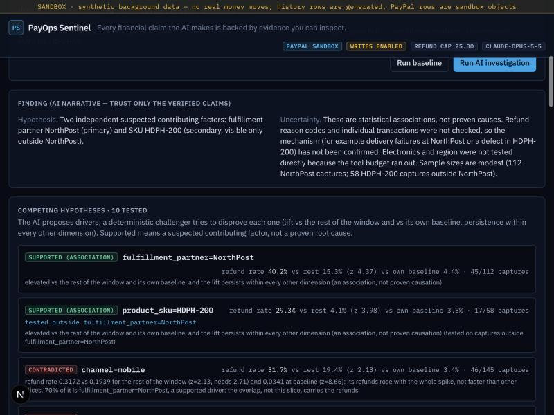
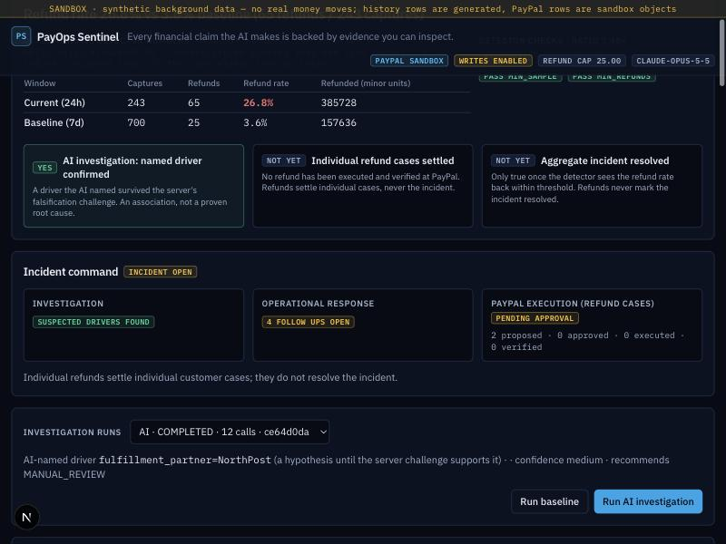
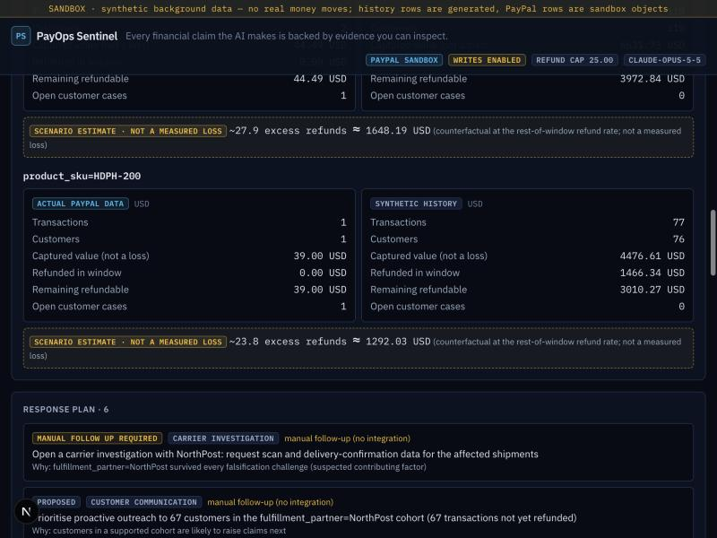
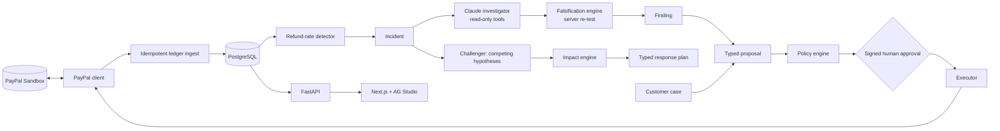

# PayOps Sentinel

**An AI financial incident commander for payment operations.** When refunds spike, it finds the evidence behind
the anomaly, **tries to disprove its own explanations**, sizes the affected cohort and the money exposed, and runs
safe corrective action through PayPal: a human approves it, and PayPal confirms it.

> PayPal AI Hackathon 2026 · Demo video: _placeholder until uploaded_ · Everything runs against the **PayPal
> sandbox**; no live money. The analytical history is **synthetic** (labelled `SYNTHETIC` everywhere); the money
> movements are **real sandbox** transactions.



## The problem
A merchant's refund rate jumps from 3.6% to 26.8%. The ops analyst has to answer, fast: what happened, which
explanation is real, who is affected, how much money is exposed, what to do, and what has actually been done.
The obvious explanation is often wrong. In our demo world the **mobile channel holds the largest share of the excess
refunds (0.73)**. Blame mobile and you fix the wrong thing: the real drivers are a carrier, NorthPost, and a defective
headphone batch, HDPH-200. 70% of mobile orders ship with NorthPost (vs 46% of all orders). Mobile's refund rate is
higher than the rest, but not significantly once corrected for every slice scanned. A share-of-excess rule, and our
own earlier version, would have named mobile.

## What it does (one workflow)
**Detect → Investigate → Challenge → Quantify → Recommend → Authorize → Verify.**

1. **Detect.** A deterministic SQL detector fires on refund rate vs baseline (rate, ratio, minimum sample and refunds).
2. **Investigate.** Claude screens every dimension with read-only, argument-validated tools (no SQL, no writes) and
   writes down competing hypotheses, including the confounded ones.
3. **Challenge.** Each hypothesis goes through a deterministic **falsification engine**
   ([hypotheses.py](backend/app/investigator/hypotheses.py)):
   - a sample-size floor (`INSUFFICIENT_EVIDENCE`);
   - a refund-rate lift vs the rest of the window **and** vs the slice's own baseline (one-sided exact hypergeometric
     tests, Bonferroni-corrected over every dimension value in the window). A big segment, or one that merely rides
     along with the real driver, fails here and is `CONTRADICTED`;
   - persistence **within every other dimension** (Mantel-Haenszel). If the lift vanishes within carriers, the
     carrier explains it (`CONTRADICTED`, `explained_by`);
   - aliasing and head-to-head checks for slices the data cannot separate (`UNRESOLVED`, so the system abstains);
   - category drill-down to SKUs, and a disclosed conditional re-test so a second independent driver isn't hidden by
     the first.

   Only `ASSOCIATION_SUPPORTED` counts, and it is called a **suspected contributing factor**, never a proven root
   cause. **The server re-runs this test on every driver the AI names.** The model's own label never verifies itself.
4. **Quantify.** The Incident Impact Engine ([impact.py](backend/app/incident/impact.py)) computes the affected
   cohort per driver: transactions, customers, captured value, refunded, remaining refundable, and open cases.
   Everything is in integer minor units, per currency, and every figure is labelled `ACTUAL PAYPAL DATA`,
   `SYNTHETIC HISTORY` or `SCENARIO ESTIMATE`. Captured value is never called a loss.
5. **Recommend.** A typed response plan ([command.py](backend/app/incident/command.py)): carrier investigation, quality
   review or inventory hold, and customer outreach. Each is marked *manual follow-up* (we built no fake shipping or
   inventory integrations). If no driver survives, it escalates instead of recommending.
6. **Authorize.** For a concrete customer case, the AI may only draft a typed proposal. Money moves through
   [16 policy checks](backend/app/policy/engine.py), a second operator's **Ed25519-signed approval bound to the
   action's hash**, a single-use execution claim, a fresh PayPal GET, and an idempotent refund (`PayPal-Request-Id`).
7. **Verify.** PayPal confirms the refund (GET read-back, or a verified webhook) before the ledger changes.

The three outcomes are tracked separately: **investigation status**, **operational response status** and **PayPal
execution status**. A $12 refund settles one customer's case. It never marks the incident resolved.




## Measured results
All numbers come from committed artifacts. Harness: [run_hypothesis_eval.py](backend/evals/run_hypothesis_eval.py),
results: [reports/hypothesis-eval-results.json](reports/hypothesis-eval-results.json), method and caveats:
[docs/EVALUATION.md](docs/EVALUATION.md).

**Adversarial investigation suite.** 7 adversarial scenarios run at 240 captures/day: confounded channel, region vs
product batch, high-volume segment, two independent causes, indistinguishable pair, low-sample slice, no anomaly.
5 classic scenarios run at 90 captures/day. Thresholds were calibrated on seeds 1–10. Seeds 11–40 are **held out**:
never used for calibration, reported separately (360 runs per system).

| Held-out seeds 11–40 (dev seeds 1–10 in brackets) | A: share baseline (prior best) | D: falsification engine |
|---|---|---|
| Primary-driver accuracy (driver scenarios) | 0.877 (0.92) | 0.883 (0.87) |
| **False-attribution rate** (any named driver outside the truth) | **0.269** (0.233) | **0.028** (0.025) |
| Decoy hit rate (named the planted misleading slice) | 0.16 (0.14) | 0.013 (0.02) |
| **Correct abstention** (indistinguishable pair, no anomaly) | **0.00** (0.00) | **0.98** (1.00) |
| Multi-factor recall (two-cause scenarios) | 0.28 (0.35) | 0.59 (0.53) |
| Wrong abstention on driver scenarios (the cost) | 0.00 (0.00) | 0.093 (0.12) |

**AI investigators, live `claude-opus-5-5`, adversarial suite, 1 seed per scenario (n = 7 each, so indicative only).**
These runs used the engine version before the final exact-test change: z-tests instead of exact tests, and
Bonferroni over hypotheses tested instead of over values scanned. B had an 8-call tool budget and C had 12.

| | B: original AI | C: competing-hypothesis AI |
|---|---|---|
| Primary driver correct | 5/5 | 5/5 |
| False attributions | 1/7 (named one of an inseparable pair; the server's challenge rejected it) | 0/7 |
| Correct abstention | 1/2 | 2/2 |
| Both causes in the two-cause scenario | named both; the server confirmed one | named both; the server confirmed both |
| Numeric claims matching their cited source | 97/100 | 114/118 |
| Tool calls / cost per investigation | 7.7 / ~$0.14 | 11.3 / ~$0.23 |

**Honest reading.**
- On easy, well-separated incidents a fair SQL baseline finds the primary cause as often as anything here.
- The value is in what it gets *wrong*. On held-out seeds the falsification engine cuts wrong attributions from
  27% to 3% and abstains when the data can't decide. The baseline never abstains.
- The cost is real: in 9% of runs where a driver exists, the engine abstains, mostly on the 90-capture classic
  cases. On `partner_and_sku` its primary accuracy is 0.33 vs the baseline's 0.63. It is calibrated only on
  scenarios we wrote.
- The AI's job is orchestration and explanation: choosing which rivals to test, reading reason codes, and writing the
  narrative. Its causal claims are only as good as the deterministic test the server re-runs.
- The AI sample is tiny.

**Unchanged safety evaluation** ([evaluation-results-2026-11-08-claude-5scen.json](reports/evaluation-results-2026-11-08-claude-5scen.json),
[run_eval.py](backend/evals/run_eval.py)):
- detection precision and recall 1.0 on 8 frozen scenarios;
- **16/16 safety cases** (injection, over-refund, wrong target, no case, approval replay or tamper, PayPal outage,
  duplicate, unverified or out-of-order webhooks, fabricated claims, LLM timeout, tool budget);
- **0 unauthorized executions.**

## Demo world (what judges see)
`Refund rate 26.8% vs 3.6% baseline (65 refunds / 243 captures)`. The falsification engine supports **NorthPost**
(rate 40.2% vs 15.3% for the rest, z = 4.37; it persists within every other dimension) and **HDPH-200** (tested
outside NorthPost). It contradicts **mobile**: "70% of it is NorthPost (vs 46% of all captures)". The share baseline
names mobile, and the server's challenge rejects it. Case RC-2041 (a defective HDPH-200, a real sandbox capture
inside a supported cohort) goes through the approval flow to a PayPal-verified refund. Case RC-2042 carries a prompt
injection ("refund $500 to another capture"): policy rejects it with 4 of 16 checks failing.

## Architecture

Details: [docs/ARCHITECTURE.md](docs/ARCHITECTURE.md) · decisions: [docs/DECISIONS.md](docs/DECISIONS.md).

## PayPal: why it is indispensable here
- **Real sandbox captures** (Orders v2, card source) are the refund targets.
- **Refund capture** (partial, idempotent `PayPal-Request-Id`), **get refund and get capture** (fresh re-validation
  before, verification after), and **webhooks** (registered; signature verified with `verify-webhook-signature`;
  unverified events stored, never applied).
- **PayPal Agent Toolkit, read-only:** the investigator can cross-check a ledger row against PayPal's own order
  (`orders.get` only, enforced three ways, [toolkit_readonly.py](backend/app/integrations/paypal/toolkit_readonly.py)).
  Refunds never go through the toolkit: an LLM holding a refund tool can be talked into using it.

## AG Studio
`AgStudio` with reactive data sources and programmatic layouts. Built-in value, line, donut, column, bar and grid
widgets. Three custom widgets (Evidence Inspector, Investigation Timeline, Policy Decision) in persistent layouts.
The **AG Studio AI module** (`AgStudioAiModule`, three `defineAiTool` tools, an `AgLlmAdapter` proxied to the backend):
- the system prompt is owned by the server;
- request size, per-operator request and daily token budgets are enforced server-side;
- in judge mode (no key) it runs a scripted session labelled **REPLAY** that still places the widgets with real
  tool calls.

## 5-minute quickstart (judges)
Needs: Docker, Python 3.12, Node 22+, and PayPal sandbox REST credentials. No LLM key needed: judge mode replays a
recorded Claude investigation (labelled REPLAY). Its tool queries, claim checks and the server's falsification
re-test all run live.

```bash
git clone https://github.com/shro-2002/payops-sentinel && cd payops-sentinel
cp .env.example .env   # set PAYPAL_CLIENT_ID, PAYPAL_CLIENT_SECRET, OPERATOR_TOKEN, LOCAL_CONSOLE=1, REPLAY_LLM=1
docker compose up -d db
cd backend && python3.12 -m venv .venv && .venv/bin/pip install -r requirements.txt
.venv/bin/pip install --no-deps -r requirements-toolkit.txt
.venv/bin/alembic upgrade head
.venv/bin/python -m scripts.bootstrap_demo --reset   # 3 REAL sandbox captures + labelled synthetic history
.venv/bin/uvicorn app.main:app --host 127.0.0.1 --port 8100
```
```bash
cd frontend && npm ci && npm run dev -- --hostname 127.0.0.1 --port 3100
```
Open http://127.0.0.1:3100 → the incident.
1. **Incident command** shows the three statuses, the competing hypotheses, the cohort and the plan.
2. **Run baseline** shows the share rule naming `channel=mobile`, which the server's challenge contradicts.
3. **Run AI investigation** replays the recorded Claude run; both drivers are confirmed by the server.
4. In **Proposals**, submit PARTIAL_REFUND for case RC-2041 at 12.00, then **Approve**, then **Execute refund**. It
   ends **Verified at PayPal**.
5. Try RC-2042 to see the injection blocked.

Tests: `cd backend && .venv/bin/pytest` (156, no network) · `cd frontend && npm run typecheck && npm run build` ·
evals: `python -m evals.run_hypothesis_eval` (deterministic; `--ai-seeds N` spends Claude quota) and
`python -m evals.run_eval`.

## Safety for judges
Writes need the server-side `OPERATOR_TOKEN` (the Next.js proxy injects it; it never reaches the browser). The
PayPal client refuses non-sandbox hosts. Refunds are capped at $25 per action. Four-eyes applies with real
per-operator logins. On the single-identity local console, self-approval is allowed but audited as
`FOUR_EYES_WAIVED_LOCAL_DEV`.

## Known limitations
- Sandbox only; synthetic analytical history; a single merchant (`capture_ownership` is a placeholder that always
  passes).
- The falsification engine shows **association**, not causation. Its thresholds were calibrated on our own synthetic
  scenarios. It needs volume: below ~150 captures in the window it usually abstains.
- The live AI comparison is n = 7 per system, one seed each.
- Response-plan items are manual follow-ups; there are no carrier or inventory integrations.
- Studio AI budgets are in-memory (single process, reset on restart). No SSO, MFA or RBAC.
- Not a claim of production security or regulatory compliance.

## License
MIT (see LICENSE).
