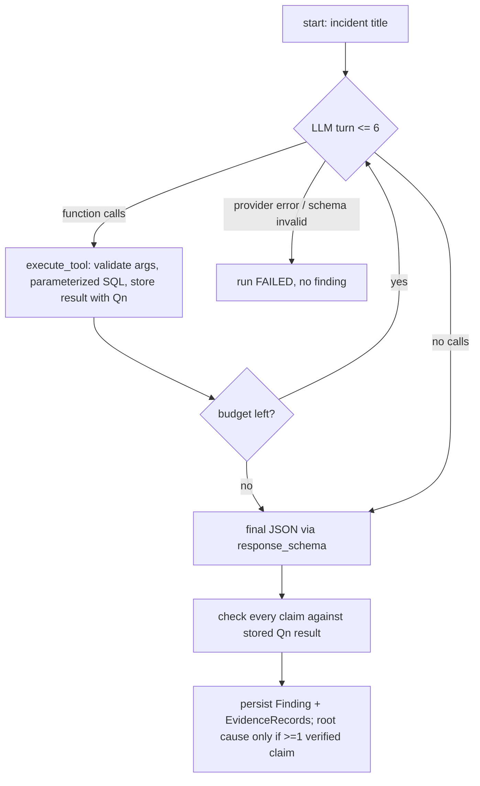

# Architecture

```mermaid
flowchart LR
  PP[(PayPal Sandbox REST)] <-- OAuth / Orders v2 / Captures / Refunds --> CL[PayPal client\nsandbox-locked, idempotent]
  PP -. webhooks .-> WH[/webhooks/paypal\nsignature verify/]
  CL --> ING[Ledger ingest\nidempotent, monotonic]
  WH --> ING
  SYN[Synthetic history\norigin=SYNTHETIC] --> ING
  ING --> DB[(PostgreSQL\nledger + investigations + actions + audit)]
  DB --> DET[Refund-rate detector\ndeterministic SQL]
  DET --> INC[Incident]
  INC --> AI[AI investigator\nGemini, read-only tools, <=8 calls]
  INC --> BL[Baseline investigator\nfixed queries]
  AI --> EV[Evidence checker\nclaim = query_id + path + value]
  EV --> F[Finding\nverified / unsupported claims]
  RC[Remediation case\nconcrete complaint] --> DR[AI drafter]
  DR --> PR[ActionProposal]
  PR --> POL[Policy engine\n16 deterministic checks per refund]
  POL --> HUM{Human approval\nbound to sha256 details}
  HUM --> EX[Executor\nsingle-use claim, GET revalidate,\nstable idempotency key, GET verify]
  EX --> CL
  DB --> API[FastAPI]
  API --> UI[Next.js + AG Studio console\nserver-side token proxy]
```

## Agent runtime graph (one investigation)

## Trust boundaries
1. Browser ↔ Next.js: no secrets in the browser; Next server proxy injects the operator token.
2. Next.js ↔ FastAPI: every write needs the operator bearer token (constant-time compare). No token configured ⇒
   writes disabled.
3. FastAPI ↔ LLM: model sees tool results and untrusted customer text as data; it has no write tools, no SQL, no network.
4. FastAPI ↔ PayPal: sandbox-only; every money movement passes policy + approval + revalidation.
5. PayPal → webhook: untrusted until `verify-webhook-signature` returns SUCCESS.
