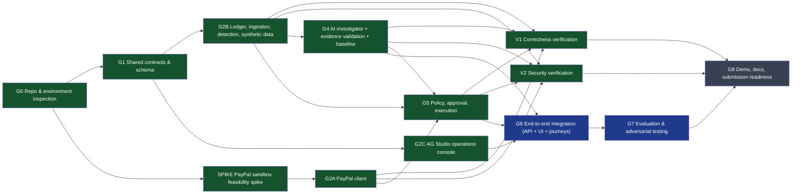

# Development Task Graph

Methodology: graph-engineering *task graphs* (`~/.claude/skills/graph-engineering/references/task-graphs.md`).
Source of truth: [`task-graph.json`](task-graph.json); this page is rendered by `python3 scripts/render_task_graph.py`.

Shape used: **diamond** — G1 plan/contracts → parallel G2A/G2B/G2C (disjoint file ownership) → independent
verifiers V1/V2 in separate contexts → single integration owner merges → G6 integration → G7 eval → G8.
Fake edges removed: G2C (UI) does not depend on G2A (PayPal client) — it only consumes the HTTP contract, so it ran
in parallel with backend work. SPIKE ran before G2A because G2A consumed its verified request shapes.

Human gates (irreversible edges): every real refund (server-enforced approval bound to details hash), publishing
the repo, deploying, uploading the video, submitting to Devpost.

Stop rule applied: sequential work (investigator → policy → executor) stayed with one agent; only the UI and the
two verifiers were delegated.

<!-- graph:start -->

| ID | Task | Depends on (consumes output of) | Parallel | Owner files | Verifier | Status | Evidence |
|---|---|---|---|---|---|---|---|
| G0 | Repo & environment inspection | - | no | `(read-only)` | integration owner | done | API_FEASIBILITY #1 |
| G1 | Shared contracts & schema | G0 | no | `backend/app/db/models.py, backend/alembic/, docs/adr/` | V1 | done | migrations 52090277ad13, 517a312dae06 |
| SPIKE | PayPal sandbox feasibility spike | G0 | yes | `backend/app/integrations/paypal/` | integration owner | done | API_FEASIBILITY #2-#9 |
| G2A | PayPal client | SPIKE | yes | `backend/app/integrations/paypal/` | V1,V2 | done | client.py; live Journey B |
| G2B | Ledger, ingestion, detection, synthetic data | G1 | yes | `backend/app/ledger/, backend/app/detection/` | V1 | done | tests/test_detection_and_baseline.py, test_ledger_and_investigator.py |
| G2C | AG Studio operations console | G1 | yes | `frontend/` | V1 (product), integration owner | done | worker report: build/typecheck/token-check/Playwright pass |
| V1 | Correctness verification | G2A, G2B, G4, G5 | yes | `(read-only)` | independent agent | done | docs/VERIFICATION.md |
| V2 | Security verification | G2A, G2B, G4, G5 | yes | `(read-only)` | independent agent | done | docs/VERIFICATION.md |
| G4 | AI investigator + evidence validation + baseline | G2B | no | `backend/app/investigator/` | V1,V2 | done | live run 10/10 claims; tests |
| G5 | Policy, approval, execution | G2A, G2B, G4 | no | `backend/app/policy/, backend/app/actions/` | V2 | done | tests/test_actions_policy.py; refund 1Y397979BV657782S |
| G6 | End-to-end integration (API + UI + journeys) | G4, G5, G2C | no | `backend/app/api/, backend/scripts/` | integration owner + Playwright | in_progress | Journeys A/B/C via API done; UI pending |
| G7 | Evaluation & adversarial testing | G6 | no | `backend/evals/, reports/` | integration owner | in_progress | 24 scenarios run 2026-11-08 |
| G8 | Demo, docs, submission readiness | G7, V1, V2 | no | `README.md, docs/` | product verifier | pending | - |
<!-- graph:end -->
